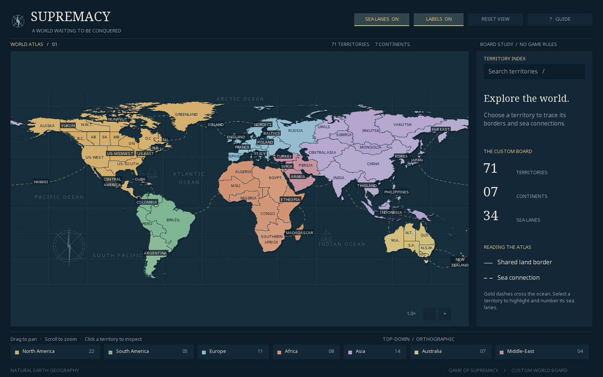

# Game of Supremacy

A custom world-conquest **board in Java and libGDX**. The camera looks directly down at a flat board and stays orthographic when zooming or panning. This milestone contains the board and its connection graph; armies, turns, combat, and continent bonuses are not implemented yet.



## Run

Install a **JDK 17 or newer**. The Maven wrapper downloads the build tools and dependencies on the first run; the built app runs offline.

```sh
# macOS / Linux
./mvnw clean verify
java -jar target/supremacy-board-0.1.0.jar
```

On macOS, launch with `java -XstartOnFirstThread -jar target/supremacy-board-0.1.0.jar`.

```powershell
# Windows
.\mvnw.cmd clean verify
java -jar target\supremacy-board-0.1.0.jar
```

The JAR bundles libGDX/LWJGL desktop libraries and all board/font assets. A desktop display and OpenGL support are required. The application was built and exercised on Linux with Java 21 and software OpenGL; Windows and macOS have not been run in this environment.

## The board

- **71 territories**, **7 continents**, **112 land links**, and **34 bidirectional sea lanes**.
- Every Canadian province and all three northern territories; Alaska, four US regions, Hawaii, Cuba, and Greenland.
- Five mainland Australian states, Northern Territory, and New Zealand. Tasmania is merged into Victoria; ACT is included with New South Wales.
- European Russia, Urals, western Siberia, **Irkutsk**, **Yakutsk**, and Far East.
- North America, South America, Europe, Africa, Asia, Australia, and a separate **Middle-East** containing Arabia, Turkey, Syria, and Persia.
- Belgium belongs to France, Tanzania belongs to Ethiopia, and northern Mauritania belongs to Algeria. Chad is split among Mali (southwest), Egypt (north), and Ethiopia (southeast).
- Unlisted countries are grouped with nearby named territories. For example, Portugal belongs to Spain, Guyana to Brazil, and Pakistan to India. Repeated US-East and Baltics entries are deduplicated; US-West covers the western states.
- Original ocean decoration: graticule, waves, sailing vessels, ocean lettering, and compass rose. Gold dashed sea lanes are visually distinct from solid borders; selecting a territory highlights its routes and numbers them to match the inspector. Pacific crossings continue at both map edges.

See [every territory grouping and sea route](docs/TERRITORIES.md). Geographic regions are gameplay abstractions, not statements about sovereignty. Antarctica and remote subantarctic islands are omitted. Tiny islands and coastlines are simplified, and internal lakes are filled. Natural Earth data is public domain; no Risk artwork is used.

## Explore

| Action | Control |
| --- | --- |
| Inspect / select a territory | Hover / left click |
| Follow a connection | Click a neighbour in the inspector |
| Pan | Drag the board |
| Zoom | Mouse wheel or `+` / `-` |
| Search and focus a territory | Click search or `/`, type, then `Enter` |
| Filter a continent | Click its legend entry; click again to clear |
| Show / hide labels | `L` or Labels button |
| Show / hide sea lanes | `S` or Sea lanes button |
| Reset view and filters | `Home`, `R`, or Reset view |
| Clear search / selection or close guide | `Esc` |
| Open the guide | `F1` or Guide button |

Dense provinces/states use familiar abbreviations at the overview scale. Full labels appear when zoomed in. Overlapping labels yield to the selected or hovered territory; every territory remains accessible through search. The inspector truncates long inclusion lists; the territory guide contains the complete lists.

## Development

`Board` loads and validates `src/main/resources/board.json`, including unique IDs, geometry, undirected connections, and whole-board reachability. It has no combat or turn logic. `AtlasCamera` owns the fixed overhead transform; `AtlasApp` renders polygons and handles exploration. `DesktopLauncher` starts LWJGL3. Geometry is triangulated once at load time.

`./mvnw test` checks the requested regions and grouping rules, graph connectivity, symmetric/unique edges, representative hit tests, polygon triangulation, and camera zoom/pan behavior.

For a reproducible screenshot of the real app:

```sh
java -Dsupremacy.screenshot=/absolute/path/board.png -jar target/supremacy-board-0.1.0.jar
```

The screenshot command captures the framebuffer after eight frames and exits. On macOS, also pass `-XstartOnFirstThread`.

To change the geography, edit `tools/generate_board.py` and regenerate:

```sh
python -m venv tools/.venv
# Activate the virtual environment using the command for your OS.
python -m pip install -r tools/requirements.txt
python tools/generate_board.py
```

The generator downloads two Natural Earth source files (about 42 MB total) from a pinned revision into `tools/cache/`, groups and simplifies their polygons, and writes both the JSON board and territory guide. Python and those source downloads are **not** needed to build or run the Java app. See [third-party notices](docs/THIRD_PARTY.md) and [verification notes](docs/VERIFICATION.md).
