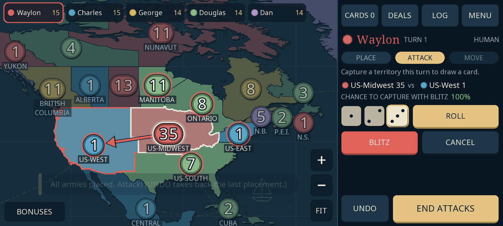
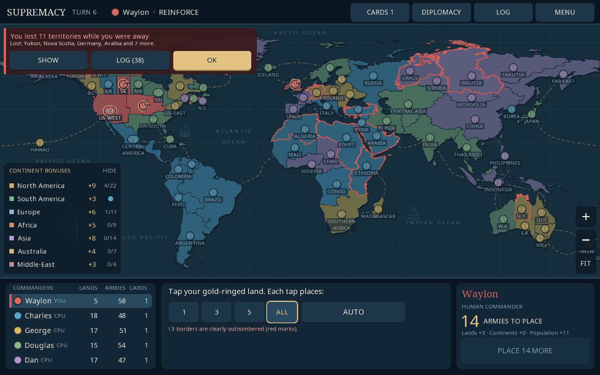

# Game of Supremacy

An **offline Android conquest game in Java/libGDX**, built around a custom 72-territory world board. Play with exactly five participants: one to five humans sharing a device, filled out by Charles, George, Douglas and Dan.

The interface adapts to the screen it runs on. On a phone the map fills the screen beside a command dock; on tablets and desktops a console sits under the map. Text and buttons keep their physical size, territories are coloured by owner, and every army count stays readable. Matches include random territories, starting armies (35, 45, 55 or 70), Risk dice and escalating cards, world conquest, private hands, automatic saves, trade offers, army gifts and open borders. Six AI difficulties plan persistent campaigns; their turns play out on the map at normal or fast speed, or can be skipped.





See [the full rules and chosen defaults](docs/GAME_RULES.md), [territory groupings](docs/TERRITORIES.md), [verification](docs/VERIFICATION.md) and [the playability plan](docs/PLAYABILITY_PLAN.md).

## Install on Android

Download [GameofSupremacy_v0.3.0.apk](downloads/GameofSupremacy_v0.3.0.apk) from this branch and open it on **Android 8.0 or newer**. Allow installation from the browser/file manager when Android asks. This is a debug-signed build for direct installation. It contains ARMv7, ARM64 and x86-64 native libraries, works offline and requests no Internet permission (only vibration, for haptic feedback). Landscape orientation is enforced. All map, font and audio assets are bundled.

If an earlier version is installed, uninstall it first: each debug build is signed with a different key, so Android refuses to update over it. CI also builds the APK on every push and attaches it to tagged releases; see [downloads/README.md](downloads/README.md).

## Build the APK

Use JDK 17 or 21 and an Android SDK with platform 35 and build tools 35.0.0. Set `ANDROID_HOME` or set `sdk.dir` in an untracked `local.properties`. The wrapper downloads Gradle 8.9; Android Gradle Plugin 8.7.3 is pinned.

```sh
./gradlew :core:test :android:assembleDebug
# APK: android/build/outputs/apk/debug/android-debug.apk
```

On Windows use `gradlew.bat`. Android Studio can open this directory directly. The Android launcher lives in `android/`; `core/` compiles the shared Java source and rules tests. Java 17 APIs are desugared for older Android versions. A signed release APK is built by CI when signing secrets are configured (see `.github/workflows/build.yml`).

## Desktop development

A desktop launcher remains available for development and automated interaction checks:

```sh
./mvnw clean verify
java -jar target/supremacy-game-0.3.0.jar
```

On macOS add `-XstartOnFirstThread` to the Java command. On Windows use `mvnw.cmd`. Desktop data defaults to `~/.supremacy`; `-Dsupremacy.saveDir=/path/to/test-data` isolates saves and preferences for tests. `-Dsupremacy.noAudio=true` disables desktop audio initialization on machines without an audio device. `-Dsupremacy.density=2.625` with a 2400×1080 window shows exactly what a 6.5-inch phone shows.

`tools/screenshot_tour.sh` plays a scripted match through the real interface at phone, small-phone, tablet and desktop sizes, checks that every control is on screen and large enough to tap, and saves screenshots to `target/tour/`. `tools/android_smoke.sh` does the same kind of check on an Android emulator or device. Both run in CI.

## Playing

On the title screen, tap a seat to switch it between **Human** and **Computer**, pick a computer skill level and match options, and start a new game (or resume the autosave). Every human enters a name (Android opens the system keyboard) and chooses a colour. A three-step guide explains the controls in the first game. With one human there is no pass-the-device screen; with several, a handover screen keeps each player's cards private.

The dock (phone) or console (tablet, desktop) always tells you what to do next:

- **Place armies:** your territories are ringed in gold. Each tap places 1, 3, 5 or ALL of your armies, or **AUTO** places them along your fronts. A red **!** marks a border where an enemy stack clearly outnumbers you. Once your last army is down (and you have no card set to trade) the game moves on to attacking.
- **Attack:** tap one of your ringed territories, then an enemy neighbour, or tap the enemy first and your strongest bordering territory is picked. On phones the map zooms in on the fight. Pick 1–3 dice and **Roll**, or **Blitz** to keep rolling until you capture it or run out of attackers. The chance to capture is shown before you commit. After a capture choose how many armies move in.
- **Move (fortify):** **drag** from the army badge of one of your gold-ringed territories onto a connected territory of yours (the armies travel with your finger as a token, and valid drop targets light up), or just tap the source and then the destination. Either way you choose how many armies move and confirm with **Move**; nothing moves by itself. Dragging from anywhere else pans the map. **End turn** when done.
- **Undo** takes back placements and moves until you roll dice.

Computer turns play out on the map, with the camera following the action; **Speed** switches between normal and fast and **Skip** jumps to your next turn. When your turn starts, territories you lost while away are outlined in red (gained ones in green) with a summary and the full log one tap away. Hold a territory (or tap one that is not a move) for its owner, armies, continent and neighbours; tap a continent in **Bonuses** to spotlight it. Drag to pan, pinch or double-tap to zoom, **FIT** shows the whole world. **Cards**, **Deals** (diplomacy), **Log** and **Menu** sit at the top of the dock or console. The menu has sound, vibration, computer speed, text size and map colours (owners or continents). The app saves at every meaningful moment and when paused, and hides private cards when paused in a pass-and-play game.

On desktop, hovering a territory shows its owner and armies. Keys: Enter performs the next step, R rolls, B blitzes, A auto-places, U undoes, Space skips computer turns, arrows pan, F fits the map, Esc goes back.

## Geography and implementation

Seven continents: North America, South America, Europe, Africa, Asia, Australia and Middle-East. The board retains the requested revisions: Yakutsk and Irkutsk; Belgium with France; Tanzania with Ethiopia; Tasmania with Victoria; Chad as its own territory with Cameroon, the Central African Republic and eastern Niger; northern Mauritania with Algeria. It has 113 land connections and 34 sea lanes, with original nautical decoration and Pacific wrapping.

`GameEngine` owns rules and validates commands independently of the screen or bot; it reports board events for animation and keeps an undo history for placements and moves. `GameState` is versioned save data. `BotStrategy` plans through the same commands as humans and also suggests placements for AUTO. `SaveStore` handles durable JSON saves and recovery; the game writes them on a background thread. `AtlasApp` sizes the interface in density-independent units, draws the map from GPU meshes built once at start-up, spreads army badges so they never overlap, and handles touch input. `GameHud` runs the turn flow, playback and in-game panels; `Screens` draws the dialogs; `Draw` holds the shared controls. `DesktopLauncher` and `AndroidLauncher` use the same game.

The checked-in board is generated from pinned public-domain Natural Earth sources. To modify it, install `tools/requirements.txt` in a virtual environment and run `python tools/generate_board.py`; Python is not needed to build or play. Sound effects are synthesized by `tools/generate_sounds.py`. See [third-party notices](docs/THIRD_PARTY.md).
