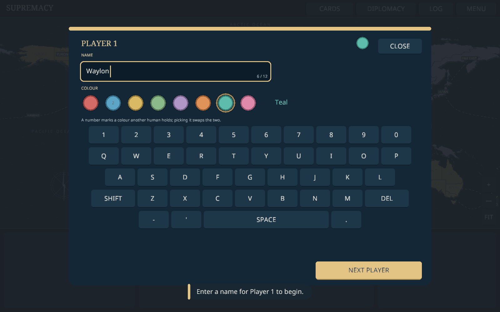

# Game of Supremacy

An **offline Android conquest game written in Rust**, built around a custom 72-territory world board. Play with exactly five participants: one to five humans sharing a device, filled out by Charles, George, Douglas and Dan. The same code runs as a desktop app for development.

The board stays directly overhead. Armies are numbered game-piece tokens in player colours, and play is laid out like the classic board game: the world map on top, a command console underneath with the commanders, the phase track (Reinforce → Attack → Fortify) and one big next-step button. Matches include random territories, 55 starting armies per player, Risk dice and escalating cards, world conquest, private hands, automatic saves, asynchronous trade offers, adjacent army gifts and open borders. Six shared AI difficulties use persistent objectives and progressively deeper planning; bot turns are summarized at the next human turn.




See [the full rules and chosen defaults](docs/GAME_RULES.md), [territory groupings](docs/TERRITORIES.md), and [verification](docs/VERIFICATION.md).

## Install on Android

Download [GameOfSupremacy-debug.apk](downloads/GameOfSupremacy-debug.apk) from this branch and open it on **Android 8.0 or newer**. Allow installation from the browser/file manager when Android asks. This is a debug-signed build for direct installation. It contains ARMv7, ARM64 and x86-64 native libraries, works offline, and requests no permissions. Landscape orientation is enforced. All map, font and audio assets are compiled into the game. If an earlier build is installed, uninstall it first (see [downloads/README.md](downloads/README.md)).

## Desktop

Install Rust 1.82 or newer ([rustup](https://rustup.rs)). On Linux the window and sound need the usual X11/OpenGL and ALSA development packages (for example `libx11-dev libxi-dev libgl1-mesa-dev libasound2-dev` on Debian/Ubuntu).

```sh
cargo test --release      # rules, bots, saves, board and camera tests
cargo run --release       # play
```

Desktop data defaults to `~/.supremacy`. Options (also `cargo run --release -- --help`):

- `--save-dir DIR` isolates saves and remembered setup (env `SUPREMACY_SAVE_DIR`).
- `--seed N` starts new matches from a fixed seed (env `SUPREMACY_SEED`).
- `--no-audio` skips loading sound effects (env `SUPREMACY_NO_AUDIO=1`).
- `--screenshot FILE.png` renders eight frames, saves a PNG and exits.
- `--script "tap 800 150; key enter; text Ada; wait 30; shot out.png; quit"` drives the game for automated interaction checks; positions are on the 1600×1000 console with y pointing up.

## Build the APK

Requirements: the Android Rust targets, a JDK (for `javac` and `keytool`), and an Android SDK with platform 35, build-tools 35.0.0 and an NDK (r25 or newer; r27 LTS is what the checked-in APK used).

```sh
rustup target add aarch64-linux-android armv7-linux-androideabi x86_64-linux-android
sdkmanager "platforms;android-35" "build-tools;35.0.0" "ndk;27.2.12479018"
ANDROID_HOME=/path/to/sdk ./android/build-apk.sh
# APK: target/android/GameOfSupremacy-debug.apk
```

The script builds the library as a shared object for each ABI, compiles miniquad's small Java activity, then links, aligns and signs the APK with your debug key (creating `~/.android/debug.keystore` if needed). `android/AndroidManifest.xml` holds the package ID, orientation and SDK levels.

## Playing

On the title screen, tap a seat to switch it between **Human** and **Computer**, pick one computer skill level, and start a new game (or resume the autosave). Every human types a name and chooses a colour: tap a human's name to open the player editor (it has its own on-screen keyboard, so it works on a phone with no system keyboard), or just press **Start new game** and you are asked for each unnamed player in turn. Names are up to 12 characters and must be unique, including against the computer players in the game; if you pick a colour another human holds, the two swap. Computers take the remaining colours. Names and colours are remembered between launches. With one human there is no pass-the-device screen; with several, a handover screen keeps each player's cards private.

The console under the map always tells you what to do next:

- **Reinforce / initial placement:** your territories are ringed in gold. Tap one, drag the slider (or use − / +) and tap **Place**. The big button stays locked until every army is placed; once your last army is down and you have no card set to trade, the game moves straight to Attack. A **Trade cards** button appears whenever you hold a matching set, and the console shows where your reinforcements came from.
- **Attack:** tap one of your ringed territories, then a pulsing enemy neighbour, or tap the enemy first and your strongest bordering territory is picked for you. Pick 1–3 dice and **Roll**, or **Blitz** to keep rolling with maximum dice until you capture it or run out of attackers. The console shows the win chance and every roll's dice, with the losing die of each pair faded. After a capture, drag the slider to choose how many armies move in; your next attack starts from the captured territory.
- **Fortify:** tap a territory, then one of the highlighted connected destinations, and move armies. **End turn** when done.

The **Continent bonuses** panel on the map shows each bonus, your progress and who holds a whole continent; tap its header to hide it. Tap an opponent in the commander list to open diplomacy with them. **Cards**, **Diplomacy**, **Log** and **Menu** are in the top bar. Drag to pan; pinch, scroll or use + / − / **Fit** to zoom. On desktop, hovering a territory shows its owner and armies; Enter performs the next step, R rolls, B blitzes and Esc (or Android Back) goes back. The app saves after every action and shows the handover screen when a hotseat game returns from the background.

## Geography and implementation

Seven continents: North America, South America, Europe, Africa, Asia, Australia and Middle-East. The board retains the requested revisions: Yakutsk and Irkutsk; Belgium with France; Tanzania with Ethiopia; Tasmania with Victoria; Chad as its own territory with Cameroon, the Central African Republic and eastern Niger; northern Mauritania with Algeria. It has 113 land connections and 34 sea lanes, with original nautical decoration and Pacific wrapping.

The crate is split into platform-neutral rules and a thin front end:

- `src/board.rs` loads `assets/board.json`, triangulates territories and checks the adjacency graph.
- `src/game/engine.rs` (`GameEngine`) owns every rule and validates commands independently of the screen or bot; `state.rs` is the versioned save data; `bot.rs` (`BotStrategy`) plans through the same commands as humans; `odds.rs` holds exact battle odds; `save.rs` (`SaveStore`) writes durable JSON saves with a known-good backup.
- `src/ui/` is the [macroquad](https://macroquad.rs) front end: `atlas.rs` draws the map, army tokens and sea lanes; `hud.rs` draws the command console and manages setup, handovers, cards, offers and reports; `camera.rs` is the flat pan/zoom transform; `gfx.rs` draws in a fixed 1600×1000 console space letterboxed into any window.
- `src/main.rs` is the desktop launcher; `quad_main` in `src/lib.rs` is the Android entry point.

The checked-in board is generated from pinned public-domain Natural Earth sources by `tools/board-gen`, which downloads and checksums the sources and runs the geometry on GEOS 3.14.1 compiled from source. It reproduces `assets/board.json` and `docs/TERRITORIES.md` byte for byte. It is not needed to build or play:

```sh
cargo run --release -p board-gen   # needs cmake and a C++ compiler for GEOS; caches sources in tools/cache
```

See [third-party notices](docs/THIRD_PARTY.md).
