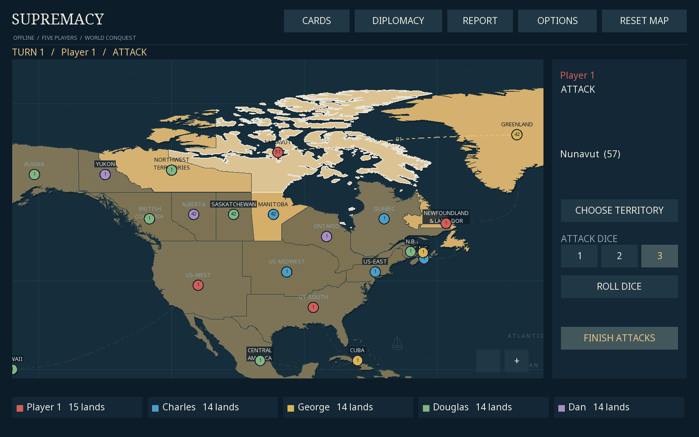

# Game of Supremacy

An **offline Android conquest game in Java/libGDX**, built around a custom 71-territory world board. Play with exactly five participants: one to five humans sharing a device, filled out by Charles, George, Douglas and Dan.

The board stays directly overhead. Armies are numbered circles in player colours. Matches include random territories, 55 starting armies per player, Risk dice and escalating cards, world conquest, private hands, automatic saves, asynchronous trade offers, adjacent army gifts and open borders. Six shared AI difficulties use persistent objectives and progressively deeper planning; bot turns are summarized at the next human turn.



See [the full rules and chosen defaults](docs/GAME_RULES.md), [territory groupings](docs/TERRITORIES.md), and [verification](docs/VERIFICATION.md).

## Install on Android

Download [GameOfSupremacy-debug.apk](downloads/GameOfSupremacy-debug.apk) from this branch and open it on **Android 8.0 or newer**. Allow installation from the browser/file manager when Android asks. This is a debug-signed build for direct installation. It contains ARMv7, ARM64 and x86-64 native libraries, works offline, and requests no Internet permission. Landscape orientation is enforced. All map, font and audio assets are bundled.

## Build the APK

Use JDK 17 or 21 and an Android SDK with platform 35 and build tools 35.0.0. Set `ANDROID_HOME` or set `sdk.dir` in an untracked `local.properties`. The wrapper downloads Gradle 8.9; Android Gradle Plugin 8.7.3 is pinned.

```sh
./gradlew :core:test :android:assembleDebug
# APK: android/build/outputs/apk/debug/android-debug.apk
```

On Windows use `gradlew.bat`. Android Studio can open this directory directly. The Android launcher lives in `android/`; `core/` compiles the shared Java source and rules tests. Java 17 APIs are desugared for older Android versions.

## Desktop development

A desktop launcher remains available for development and automated interaction checks:

```sh
./mvnw clean verify
java -jar target/supremacy-game-0.2.0.jar
```

On macOS add `-XstartOnFirstThread` to the Java command. On Windows use `mvnw.cmd`. Desktop data defaults to `~/.supremacy`; `-Dsupremacy.saveDir=/path/to/test-data` isolates saves and preferences for tests. `-Dsupremacy.noAudio=true` disables desktop audio initialization on machines without an audio device.

## Playing

Choose the number of humans and one shared bot difficulty, then start a match. During setup, tap one of your territories (or use **Choose territory**), set an amount and deploy. Place the entire reserve, then finish setup. A handover screen identifies the next human.

Each turn proceeds through **Reinforce → Attack → Occupy captured land → Fortify → End turn**. Tap your territory and an adjacent enemy to attack. Each roll is a separate decision; defending dice are automatic. During fortification, tap a source and destination; use Choose territory to reset the source. Pinch or use the zoom buttons to zoom, and drag to pan. Private cards, reports, diplomacy and rules are available from the top controls. The app saves every action and hides private cards when paused.

## Geography and implementation

Seven continents: North America, South America, Europe, Africa, Asia, Australia and Middle-East. The board retains the requested revisions: Yakutsk and Irkutsk; Belgium with France; Tanzania with Ethiopia; Tasmania with Victoria; Chad divided among Mali, Egypt and Ethiopia; northern Mauritania with Algeria. It has 112 land connections and 34 sea lanes, with original nautical decoration and Pacific wrapping.

`GameEngine` owns rules and validates commands independently of the screen or bot. `GameState` is versioned save data. `BotStrategy` plans through the same commands as humans. `SaveStore` handles durable JSON saves and recovery. `AtlasApp` draws the map and touch controls; `GameHud` manages setup, handovers, cards, offers and reports. `DesktopLauncher` and `AndroidLauncher` use the same game.

The checked-in board is generated from pinned public-domain Natural Earth sources. To modify it, install `tools/requirements.txt` in a virtual environment and run `python tools/generate_board.py`; Python is not needed to build or play. See [third-party notices](docs/THIRD_PARTY.md).
