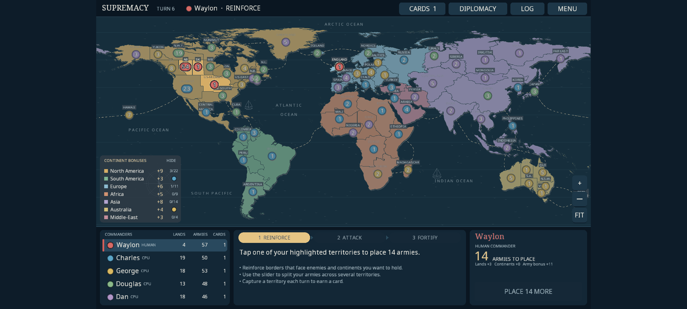

# Playability and UI plan

Status: implemented in version 0.3.0, with the exceptions listed under "Status by milestone".
The rest of this document is the original plan as written against 0.2.1.

## Status by milestone

| Milestone | Done | Not done or changed |
| --- | --- | --- |
| M0 feedback loop | Screenshot tour at four sizes plus pass-and-play, with layout checks; CI builds the APK, runs the tour, runs the APK on an Android emulator and publishes APKs on tags. | The committed APK in `downloads/` is kept (updated to 0.3.0) because it is how the game is installed today. |
| M1 responsive layout | Layout in density-independent units from the real screen; fonts rasterised at device pixel size; phone layout (map + dock, commander chips) and wide layout (map + console); native Android text input for names. | **Not rebuilt on Scene2D.** The existing immediate-mode UI was made fully adaptive instead, which kept every screen working throughout. Buttons are 40 dp on phones (44–56 elsewhere), not 48, so that everything fits on 360 dp-tall screens; the tour enforces at least 28 dp. |
| M2 readable map | Owner-coloured territories with a continent view in settings; continent spotlight from the bonus panel; badge collision avoidance with leader lines; badges sized in dp; auto-zoom to the fight on phones; fling, double-tap zoom, animated camera; territory details on long-press; GPU meshes for the map. | No colour-blind palette or patterns. Frame rate not yet measured on a device. |
| M3 visible turns | Engine events; computer turns played on the map with camera follow, normal/fast speed and skip; recap of lost and gained land; rising loss and gain numbers; three new sounds and haptics; background, coalesced autosave; defeat and victory screens with statistics. | A blitz still resolves instantly for humans, with the total shown, rather than animating each roll. |
| M4 forgiving flow | Undo for placements and moves; AUTO placement; tap places 1/3/5/ALL; threat markers; three-step first-game guide; starting-army and population-bonus options; drag-to-fortify (drag from a territory's army badge onto a connected one, then confirm the amount). | None. Dragging only moves armies in the fortify phase. |
| M5 polish and release | Text size, sound, vibration, computer speed and map colour settings; results screens; release signing in CI when secrets are configured. | Title screen restyled only lightly. No colour-blind mode. Release signing needs a keystore added as repository secrets. |

## Summary

The rules engine and the bots are sound. What makes the game unplayable is everything between the
player and the engine, on the device the APK is actually installed on: a phone.

- The whole interface is one fixed 1600×1000 canvas. On a phone it is shrunk and letterboxed until
  text, buttons and army tokens are a fraction of the size a finger or eye needs.
- The game has never run on Android (see [VERIFICATION.md](VERIFICATION.md)); every check so far
  was on a desktop window.
- You cannot read the board at a glance, computer turns are invisible, and mistakes cannot be
  undone.

The plan is five milestones, in order. The first two are what turn "not playable" into "playable";
the rest make it good.

## What was checked

All of this was run against the current `main` (version 0.2.1).

| Check | Result |
| --- | --- |
| `./mvnw clean verify` | Builds; all 30 tests pass. |
| 36 simulated bot-only matches (6 difficulties × 6 seeds) | Every match reached world conquest in 5–33 rounds (27–166 turns). Slowest single bot decision: 19 ms on desktop. |
| Scripted play-through of the real UI at 1600×1000 | Menu → name entry → placement → reinforce → blitz → occupy → fortify → bot turns → report → turn 2 all work. |
| The same play-through at 2400×1080 (a 20:9 phone) | Works, but see below. |
| Android device or emulator | Not possible in this environment; still unverified. |

So the game logic does not need rescuing. The problems below are all presentation, input and
platform.

## What is wrong

### 1. On a phone the UI is far too small

`AtlasApp` uses `FitViewport(1600, 1000)` and every coordinate in `GameHud` (2,282 lines) is a
hard-coded position on that canvas. On a 6.5-inch 20:9 phone (about 151 × 68 mm) that gives:

| Element | Size on the phone | Usual minimum |
| --- | --- | --- |
| Map labels and small text | 0.9 mm (about 5.5 sp) | 12 sp (1.9 mm) |
| Body text | 1.1 mm (about 7 sp) | 12 sp |
| Main instruction text | 1.4 mm (about 9 sp) | 12 sp |
| Buttons | 3.5 mm tall (22 dp) | 48 dp (7.6 mm) |
| Top-bar buttons | 2.7 mm tall (17 dp) | 48 dp |
| Army tokens (also the tap target) | 1.8 mm across (11 dp) | 48 dp |
| Black bars left and right | 28% of the screen | none |
| Map | 49% of the screen | as much as possible |

On a 10-inch tablet the same layout is borderline acceptable; it was designed at desktop size.

### 2. It has never run on Android

The APK builds and its contents look right, but nobody has launched it on a device. Touch, pinch,
audio, the back button, pause/resume and save paths are all unproven, and there is no automated way
to find out.

### 3. The board is hard to read

- Territories are filled by **continent**. Ownership, the thing you need most, is only the colour
  of a small token, and the player colours (gold, green, purple, orange) collide with the continent
  colours underneath them.
- Tokens overlap in dense areas at overview zoom. North America has 22 territories; two adjacent
  tokens showing 7 and 2 read as "72".
- On touch devices there is no way to inspect a territory: the tooltip is desktop-only
  (`GameHud.tooltip`).

### 4. Computer turns are invisible

All four bots resolve inside a few frames behind a banner, then the player gets a paged text log.
In the play-through, round one ended with "You lost 12 territories" and five pages of sentences to
explain it. Nothing happens on the map. If the only human is eliminated, the rest of the match
fast-forwards straight to the winner banner with no defeat screen.

### 5. Input is unforgiving

- No undo for placing or moving armies, and tiny targets make misplacement likely.
- Initial placement is about 40 armies by hand before the game starts, with no auto-place.
- Nothing warns a new player which borders are about to be overrun.

### 6. Performance risks on a phone (to be measured on a device)

- The map is redrawn through an immediate-mode `ShapeRenderer`: about 194,000 vertices per frame
  (16,171 polygon vertices × shadow, fill and outline), on every pan, zoom and highlight pulse.
- The game autosaves synchronously on the render thread after every engine action: 93–276 saves
  per round of bot turns, each one a write plus two re-parses of the save. That is 1–2 ms each on a
  desktop SSD and one save per roll during a blitz.

## Milestones

### M0. A real Android feedback loop (small)

Goal: every later change can be seen on a phone-sized screen before it is merged.

- Add a window-size option to the desktop launcher and check in a scripted play-through that saves
  screenshots at phone (2400×1080), small-phone (1600×720) and tablet (1280×800) sizes.
- Add a GitHub Actions workflow: run tests, build the APK, boot an Android emulator, launch the
  game, run a short tap script and upload screenshots.
- Publish the APK from CI as a release artifact instead of committing a 7 MB binary per version.

Done when: a pull request shows screenshots of the game running on an emulated phone and tablet.

### M1. Responsive layout (large; the core fix)

Goal: the game fills any landscape screen and everything is readable and tappable.

- Replace the fixed canvas with a layout computed from the real screen size and density. UI sizes
  are specified in dp; respect display cutouts and rounded corners.
- Rebuild the HUD on Scene2D.ui (libGDX's built-in toolkit) for menus, dialogs, lists and the
  action panel. It provides layout, scrolling and native text input, which the current absolute
  coordinates cannot be stretched into. The map and tokens stay custom-drawn.
- Generate fonts at the device's real pixel size so text is sharp, with a 12 sp floor.
- Two layouts from one set of panels:
  - **Phone:** the map fills the screen. A slim status strip on top (player, phase, armies to
    place), an action dock on the right or bottom, and the commander list collapsed to a row of
    chips that expands on tap.
  - **Tablet and desktop:** today's three-panel console under the map.
- Every touch target at least 48 dp.

Done when: at all three test sizes there are no black bars, no text under 12 sp and no target under
48 dp, checked by the M0 screenshot script and a layout unit test.

### M2. A map you can read and touch (medium to large)

- Fill territories with the **owner's** colour; show continents as border colour and in the bonus
  panel, with a toggle for the old continent view. Choose a palette that stays distinct for
  colour-blind players and against the ocean.
- Army badges sized in dp. When badges would collide, offset them with a leader line, and zoom to
  the selected territory and its neighbours automatically.
- Camera: fling, double-tap zoom, animated focus on the action, minimum zoom that fits the width.
- Tap a territory to select it and show an info card (name, owner, armies, continent, neighbours).
  Taps resolve to the nearest territory within 24 dp.
- Bake the map into static meshes and stop allocating per frame.

Done when: the owner of every territory is identifiable at overview zoom in a phone screenshot, and
panning holds 60 fps on a mid-range phone.

### M3. Turns you can see (medium)

- Have the engine emit structured events (deploy, attack, capture, move, trade, eliminate) alongside
  the text log.
- Play bot turns back on the map with camera follow, a speed control (1×, 2×, skip) and tap to
  skip.
- Replace "While you were away" with a recap on the map: lost territories flash red, gained ones
  green, with a short list beside it.
- Battle feedback: dice animation for both sides, a running loss count during blitz, capture
  animation, a fuller sound set and haptics.
- Move autosave off the render thread and coalesce it to phase boundaries, pending occupations and
  app pause.
- Add a defeat screen with "watch the rest" and "new game".

### M4. Forgiving flow and onboarding (medium)

- Undo for placing and moving armies until the phase is committed (no dice are involved, so this
  is safe).
- Auto-place for initial setup and a "suggest" button for reinforcements, reusing the bot's
  deployment logic.
- Faster input: tap to add one army, long-press for the slider, drag between territories to
  fortify.
- Threat markers on borders where a neighbouring enemy stack outnumbers yours.
- A three-step first-game tutorial and dismissible hints.
- Match options for starting armies and the population bonus. Defaults stay as they are.

### M5. Polish and release (medium)

- Visual pass: one type scale and spacing system, redesigned title screen, victory and defeat
  screens with match statistics.
- Settings: playback speed, sound and haptics, text size, colour-blind patterns.
- Release-signed APK built by CI.

## What stays as it is

- `GameEngine` rules, `BotStrategy`, the board data and its generator.
- The save format, apart from versioned additions for events and undo.
- Landscape orientation, offline play and no Internet permission.

## Open decisions

1. **Target device.** This plan assumes phones first, with tablets and desktop kept working.
2. **Owner-coloured territories.** This changes the look of the map the most; the continent view
   remains available as a toggle.
3. **Rules.** The 55 starting armies and the 20% population bonus are untouched. M4 only makes them
   adjustable per match.
